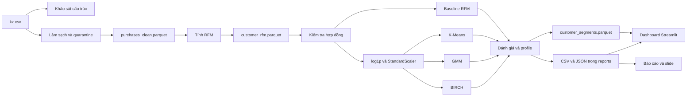

# Kiến trúc hệ thống



## Ranh giới trách nhiệm

- `src/prepare_data.py` và `src/rfm.py` xử lý dữ liệu bằng PySpark. `src/portable_rfm.py` chỉ là runner tương thích khi Python worker của Spark không chạy được trên Windows.
- `src/segmentation/features.py` kiểm tra hợp đồng và chuẩn bị đặc trưng. RFM gốc không bị ghi đè.
- `src/segmentation/baseline.py`, `models.py`, `evaluation.py` và `pipeline.py` tạo nhãn, benchmark, chọn cấu hình và ghi artifact.
- `app/data.py` chỉ đọc và kiểm tra artifact; `app/charts.py` tạo biểu đồ; `app/app.py` điều phối giao diện. Dashboard không tính lại nhãn hoặc KPI bằng một công thức khác.

## Luồng tái lập

```text
python scripts/run_pipeline.py
python scripts/run_segmentation.py --expected-rows 234359
python -m pytest -q
streamlit run app/app.py
```

File dữ liệu gốc và các Parquet lớn được loại khỏi Git. Mã nguồn, kiểm thử, metadata và các bảng kết quả tổng hợp được version-control để review được quyết định mô hình.
